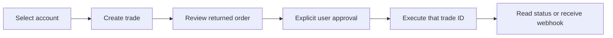

# Backend API

Use this path for a partner's own account views, portfolio UI, and draft/review/trade experience. Read the [API overview](https://docs.tradeit.app/api) and the operation page before implementing its request or result model. The [Postman collection](https://www.postman.com/trade-it/workspace/trade-it-apis/collection/5398302-70e1f409-c978-4701-a2fa-6f58b8b11932?action=share&source=copy-link&creator=5398302) is a runnable companion.

## Transport

Account and trading operations use one endpoint. Do not invent REST routes such as `/accounts/:id/holdings` from a tool name.

```http
POST https://api.tradeit.app/api/tool/execute
Authorization: Bearer <the current user's OAuth access token or personal API key>
Content-Type: application/json

{
  "toolName": "get_accounts",
  "params": {}
}
```

The JSON body is the operation result itself, not a generic `result` wrapper. Require the platform's own authenticated user before looking up that user's Trade It token. Never accept an arbitrary access token or another user's account ID as the token-storage binding.

## Operations

| Operation | Important inputs | Returned shape | Reference |
| --- | --- | --- | --- |
| `get_accounts` | `{}`; optional refresh where supported | List of entries containing `account`, `brokerage_metadata`, and `connection` | [Accounts](https://docs.tradeit.app/api/get-accounts) |
| `get_holdings` | `account_id`; optional `refresh` | Holdings list | [Holdings](https://docs.tradeit.app/api/get-holdings) |
| `get_trades` | Documented filters, cursor/limit, optional refresh | Object containing `trades` and pagination state | [Trades](https://docs.tradeit.app/api/get-trades) |
| `create_trade` | `symbol`, `amount`, `unit`, `buy_or_sell`, order fields, chosen `account_id` | Trade | [Stock/crypto creation](https://docs.tradeit.app/api/create-trade) |
| `create_options_trade` | Underlying `symbol`, `legs`, direction/order fields, chosen `account_id` | Trade | [Options creation](https://docs.tradeit.app/api/create-options-trade) |
| `execute_trade` | `trade_id` from the reviewed trade's `id` | Updated trade | [Execution](https://docs.tradeit.app/api/execute-trade) |
| `cancel_trade` | `trade_id` | Updated trade | [Cancellation](https://docs.tradeit.app/api/cancel-trade) |

Use the current API schema for exact filters and optional fields. Keep API snake_case (`account_id`, `buy_or_sell`, `order_type`, `position_effect`) distinct from SDK camelCase (`action`, `orderType`, `positionEffect`). Operation permissions and plan eligibility differ; a successful OAuth exchange does not prove every API operation is allowed.

## Read the correct account

Obtain IDs from `get_accounts`; the selectable ID is `entry.account.id`. Show the brokerage name and capabilities from the same entry. Check `connection.status` and allow reconnection when needed. Do not confuse a brokerage connection ID, a brokerage code, and an account ID.

```json
{
  "toolName": "get_holdings",
  "params": {
    "account_id": 304,
    "refresh": false
  }
}
```

Data can be cached. Use freshness timestamps and the documented refresh capability rather than presenting cached data as a live quote. Real-time refresh is subject to plan and per-account cooldown; consult the current operation page. Preserve null/unavailable values instead of displaying zero, and account for an options position's multiplier when interpreting value and cost.

## Create, review, execute



For a draft-first account, this stock example prepares an order:

```json
{
  "toolName": "create_trade",
  "params": {
    "symbol": "AAPL",
    "amount": 100,
    "unit": "dollars",
    "buy_or_sell": "buy",
    "order_type": "market",
    "time_in_force": "day",
    "account_id": 304
  }
}
```

Check the returned status. Accounts configured for automatic execution can submit during creation. If preview-only behavior is required, use a draft-first account configuration; do not promise a harmless preview or invoke a potentially executing create operation without approval.

Display the returned account, instrument, action, quantities, order type, price conditions, and options legs. Execute only after the user approves that specific order, using its returned `id` as `params.trade_id`. Do not execute a changed order using approval for an earlier draft.

An accepted/submitted order is not necessarily filled. Use `get_trades` or signed final-state webhooks to reconcile its status. Cancellation can be a brokerage request rather than instantaneous completion; display the returned state. If a write times out, reconcile the known order before retrying; do not assume that an uncertain response means no order was placed.

## Failure handling

Preserve HTTP status and the documented error fields (`error`, `error_description`, `resolution`, `validation_errors`) in the backend's handling. Handle `401` with the [refresh policy](oauth.md), `403` as permissions/plan access, and invalid input/trade state as a request issue. Do not blanket-retry trade writes or claim idempotency unless the current API explicitly provides it.
