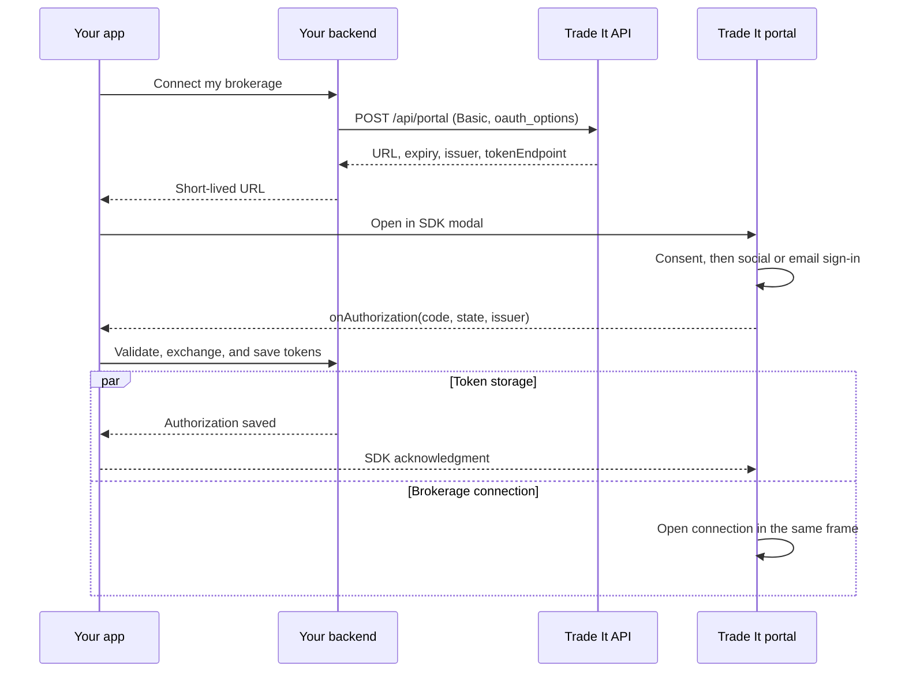

# Trade It Portal: Onboarding mode

Use Onboarding mode for consent, social or email sign-in, OAuth authorization, and the first brokerage connection in one iframe. After saving tokens, use the same portal in [Connection mode](api-contract.md#connection-mode) to add or reconnect brokerages without signing in again. Standard redirect OAuth remains available for a custom experience. Read the [onboarding guide](https://docs.tradeit.app/sdk/onboarding) for the current public contract.



## Configure the partner client

- Use a provisioned confidential partner client with its client ID and secret for Onboarding mode; dynamically registered public clients cannot start this mode.
- Set the client name, logo, and read-only or full client type in the partner settings. The portal displays those details and that client's access policy.
- Register an exact `redirect_uri` on the embedding website's origin, including scheme, hostname, and port. Register separate URIs for test and production sites. HTTPS is required outside loopback development.
- No redirect page is opened in the portal flow; the registered URI binds event delivery and the code exchange. There is no `app_origin` field.

## 1. Create the portal URL

From an authenticated partner backend, generate random state and a PKCE verifier. Store the verifier, state, and attempt expiry against the partner's signed-in user. The challenge is the base64url SHA-256 digest of the verifier, using PKCE `S256`.

Use the generation and token-storage rules in [oauth.md](oauth.md). Keep environment-specific API URLs and credentials together; do not mix alpha and production. Portal creation uses the fixed API endpoint below, not an OAuth discovery extension. The response supplies the issuer and token endpoint needed for exchange.

Send the following JSON to the API with Basic authentication. Form-encode the client ID and secret individually, join them with `:`, and base64-encode the result. The client ID comes from these credentials, not the JSON body.

```http
POST https://api.tradeit.app/api/portal
Authorization: Basic <encoded client credentials>
Content-Type: application/json

{
  "oauth_options": {
    "redirect_uri": "https://app.example.com/auth/tradeit/callback",
    "state": "<random state, 16–512 characters>",
    "code_challenge": "<43-character base64url SHA-256 challenge>",
    "email_hint": "alex@example.com",
    "name": "Alex"
  },
  "connect_options": {
    "brokerage_filter": {
      "supports": ["options"],
      "exclude": ["tastytrade"]
    }
  }
}
```

`oauth_options` is required with Basic authentication. Its `email_hint` and `name` are optional; redirect URI, state, and challenge are required. Supply `email_hint` for the consent screen's Continue action to send an email code, or omit it to show Google, Apple, X, Discord, and email sign-in after consent. Users can switch methods or correct the address. Neither the hint nor a partner-provided name proves identity.

`connect_options` is optional and has the same snake_case fields in both portal modes. Omit it for the full list, set `brokerage_filter` for a filtered list, or set `brokerage_code` for one targeted brokerage; do not combine a direct code with a filter. See [connection options](api-contract.md#connection-options). Filters customize the UI, not permissions. Do not send a separate mode flag, top-level OAuth fields, or `app_origin`.

The response contains:

```json
{
  "url": "https://tradeit.app/connect/onboarding?ticket=<ticket>&embedded=1",
  "expiresAt": "<ISO-8601 expiry, 30 minutes from creation>",
  "issuer": "<authorization server issuer URL>",
  "tokenEndpoint": "<authorization server token endpoint URL>"
}
```

Return `url` to the frontend. Retain `issuer`, `tokenEndpoint`, `expiresAt`, the exact `redirect_uri`, state, and verifier in the server-side attempt. Check for a successful response before opening the URL.

## 2. Open the portal and receive authorization

Use an SDK release that includes `onAuthorization`. Render one shared `TradeItModal` and open the returned URL as a connect launch.

```tsx
import { TradeItModal, useTradeIt } from '@trade-it/react';

export function OnboardingPortal({ url }: { url: string }) {
  const tradeIt = useTradeIt({
    onAuthorization: async authorization => {
      const response = await fetch('/api/tradeit/complete', {
        method: 'POST',
        headers: { 'Content-Type': 'application/json' },
        body: JSON.stringify(authorization),
      });
      if (!response.ok) throw new Error('Could not save authorization.');
    },
  });

  return (
    <>
      <button type="button" onClick={() => tradeIt.openConnect({ launch: { mode: 'connect', url } })}>
        Connect my brokerage
      </button>
      {tradeIt.modalProps && <TradeItModal {...tradeIt.modalProps} />}
    </>
  );
}
```

The callback receives `{ code, state, issuer }` after consent and successful sign-in. New and existing users can use social sign-in or email OTP; `email_hint` chooses only the initial experience. Social sign-in uses a popup and returns to the same portal. The underlying event is `tradeit.authorization`, but credential events go to `onAuthorization`, not `onEvent`.

Resolve the callback only after the backend has saved the OAuth tokens. Throw on failure; the SDK acknowledges failure to the portal. Brokerage connection starts immediately in the same iframe while the exchange runs, and automatic modal closure waits for token storage to succeed. Do not request or load another connection URL at this point.

The registered `redirect_uri` is not opened. It sets the exact receiving website origin and remains part of the token exchange. The SDK checks message origin and iframe source; see [OAuth 2.0 Security Best Current Practice §4.17](https://www.rfc-editor.org/rfc/rfc9700.html#section-4.17) for in-browser message security considerations.

## 3. Exchange and save tokens

The partner's completion route must authenticate its caller, check state and expiry against that user's attempt, and require the event issuer to match the stored issuer. Use the stored token endpoint; never fetch an endpoint supplied by browser code.

Exchange the authorization code server-side with client credentials and the original PKCE verifier:

```http
POST <stored tokenEndpoint>
Authorization: Basic <encoded client credentials>
Content-Type: application/x-www-form-urlencoded

grant_type=authorization_code&code=<authorization code>&redirect_uri=<original registered URI>&code_verifier=<original verifier>
```

Form-encode each parameter using `URLSearchParams`. Authorization codes are single-use and should be exchanged promptly. Save the access token, refresh token, expiration, and issuer per authenticated partner user, then complete the local attempt. Never send OAuth tokens or the client secret to the production frontend.

Use the shared [refresh and revocation policy](oauth.md#refresh-and-revocation): rotate token storage atomically, serialize concurrent refreshes, and obtain fresh authorization after `invalid_grant` rather than replaying a code.

## Subsequent connections and ownership

Once tokens are saved, call the same `POST https://api.tradeit.app/api/portal` with that user's Bearer access token and omit `oauth_options`. Optional `connect_options` works unchanged. This selects [Connection mode](api-contract.md#connection-mode) without repeating sign-in, consent, or code exchange while the authorization is valid. Do not implement repeated onboarding for subsequent connections.

Users can reuse their existing brokerage connections; those connections belong to their portable Trade It identity, not the partner.

Partner access is revocable. Already-issued access tokens can remain valid until their expiration after revocation. Email verification must be performed by the user; do not use admin identity creation or server-redeemed verification links to bypass it.
